```{r setup, echo=FALSE, include=FALSE}
knitr::opts_chunk$set(eval = TRUE, include = TRUE, echo=TRUE,
      message = FALSE, warning = FALSE,	collapse = TRUE, comment = "#>",
      out.width = "100%", fig.align = "center", fig.height = 7,	
      fig.width = 12, dev = c("svg"), dpi=500)

# Colors :
success = "#74C476"
light_green = "#E5F5E080"

warning = "#E39E4F"
light_orange = "#FED8B180"

error = "#E34234"

tips = "#1155cc"
```

# What is {width="70"} ?

R is a **programming language** developed to :

-   Manage data : import, transform, clean, process, export ...\
-   Compute **statistical analyses**, from basic to complex ones : descriptive, exploration, modelling, machine learning ...\
-   Create nice **visualisations**, reports ...

[R is free, cross-platform, open-source & collaborative !]{.smallcaps style="color: #74C476"}

## R [Pros]{style="color: #74C476"} & [Cons]{style="color: #E34234"}

::::: columns
::: {.column .fragment .fade-in width="50%" style="background-color: #E5F5E080; font-size: 80%;"}
-   Advanced tool with infinite options
-   Open-source & free
-   Reproducibility : notebooks, scripts
-   Big active community
-   Numerous well-documented packages, even for very niche fields
:::

::: {.column .fragment .fade-in width="50%" style="background-color: #FED8B180; font-size: 80%;"}
-   Hard learning curve
-   Express correctly your needs to find correct & useful info
-   Have knowledge in the methods you use to interpret results correctly and detect pitfalls or missues
:::
:::::

## R vs Excel / Prism

::::: columns
::: column
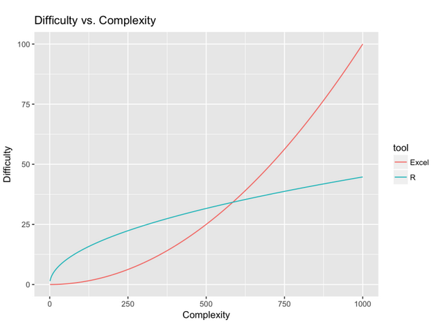{fig-align="center"}
:::

::: column
](img/covid.png){fig-align="center"}
:::
:::::

## Automate repetitive task

A way to gain free time ?

 website](img/xkcd.png){fig-align="center"}

## What can't R do ?

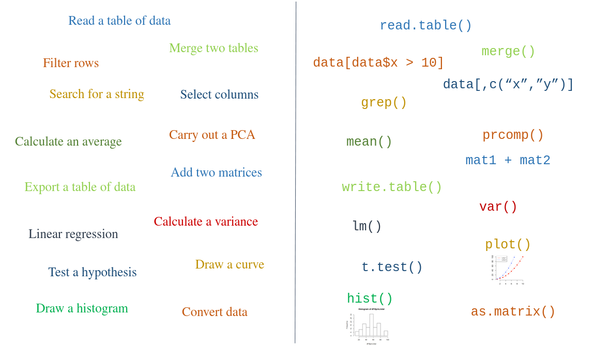{fig-align="left"}

## How to run R ?

-   Using command line from a terminal 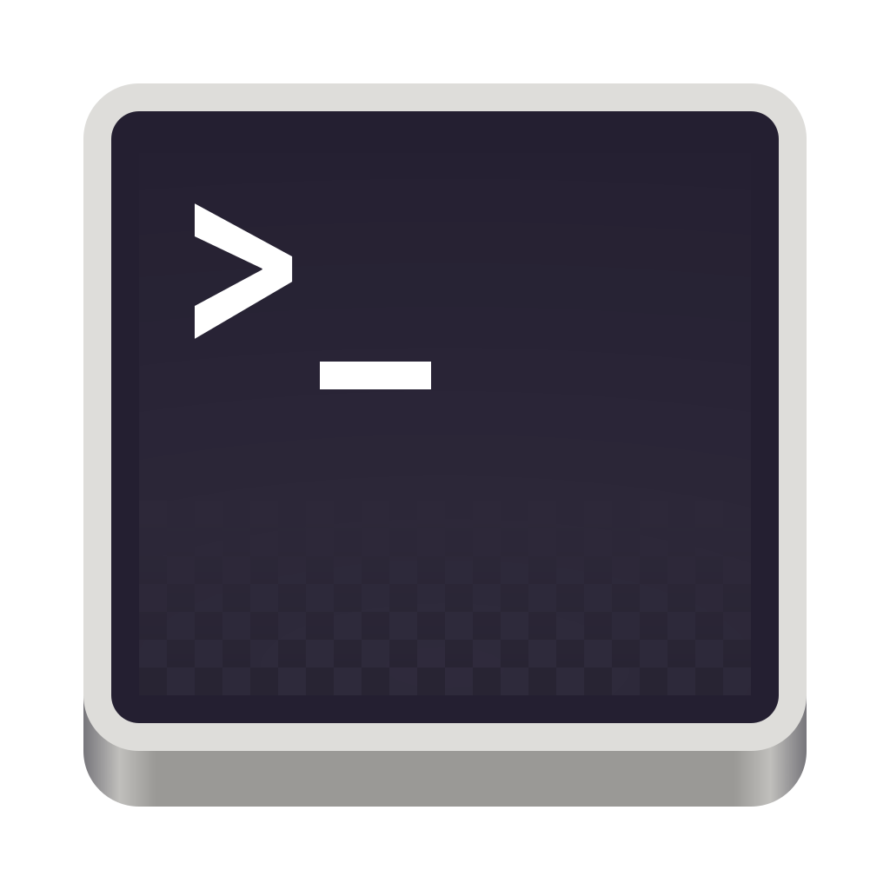{width="50px"}
    -   locally
    -   via `ssh`
-   Using an interface : {width="120px"}
    -   locally (Rstudio installed)
    -   via a server {width="200px"}

# Let's try !

Go to [https://ondemand.cluster.france-bioinformatique.fr](https://ondemand.cluster.france-bioinformatique.fr){.external target="_blank"} and open `R_practice.qmd` script

[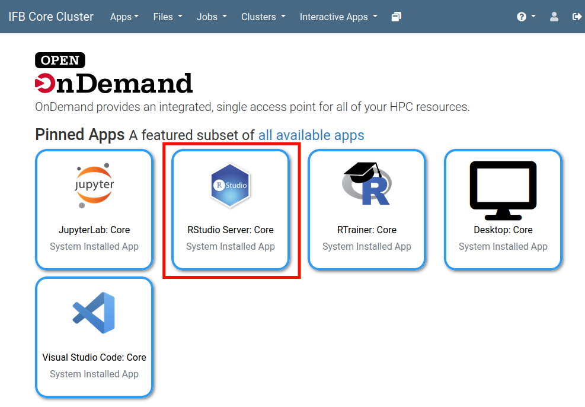{fig-align="center" width=70%}](https://ondemand.cluster.france-bioinformatique.fr){.external target="_blank"}

## Rstudio interface

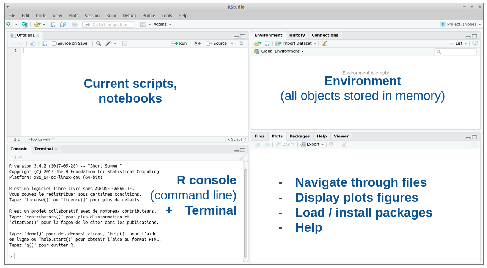

## Get the materials

In the **terminal**, go to your project space and copy `TP_R` folder from the common project space using `cp`

```{bash, eval=F}
cd /shared/projects/your_project_name/
cp -r /shared/projects/2621_eb3in1_2026/cours_commun/TP_R/ .
```

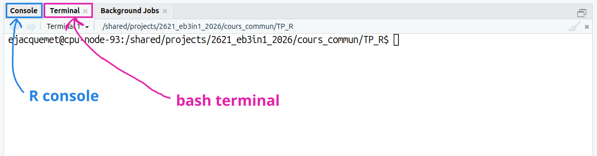

## Working directory

To know where you currently are:

```{r, eval=F}
getwd()
```

Set your working directory to the `intro_R` folder in your project space
```{r, eval=F}
setwd('/shared/projects/your_project_name/TP_R')
```

## Files

Refresh your files in Rstudio, your should see the following :

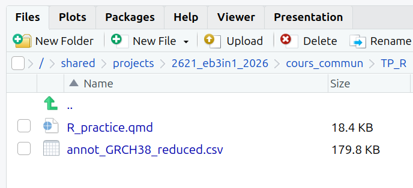{.absolute width=800}

# Basic operations

:::{.r-fit-text}
R can be used as a giant calculator, to compute mathematical operations
::: 
```{r}
#| eval: false

2 + 3

4 * 5

6 / 4

1,2

1.2
```

::: {.callout-tip}
Execute line by line with `ctrl` + `enter`
::: 

## Basic operations

:::{.r-fit-text}
R can be used as a giant calculator, to compute mathematical operations
::: 

```{r}
#| code-line-numbers: "1"
#| echo: true
#| results: false
#| eval: false

2 + 3

4 * 5

6 / 4

1,2

1.2
```

```{r}
#| echo: false
2+3
```

## Basic operations

:::{.r-fit-text}
R can be used as a giant calculator, to compute mathematical operations
::: 
```{r}
#| code-line-numbers: "3"
#| echo: true
#| results: false
#| eval: false

2 + 3

4 * 5

6 / 4

1,2

1.2
```

```{r}
#| echo: false
4*5
```

## Basic operations

:::{.r-fit-text}
R can be used as a giant calculator, to compute mathematical operations
::: 
```{r}
#| code-line-numbers: "5"
#| echo: true
#| results: false
#| eval: false

2 + 3

4 * 5

6 / 4

1,2

1.2
```

```{r}
#| echo: false
6/4
```

## Basic operations

:::{.r-fit-text}
R can be used as a giant calculator, to compute mathematical operations
::: 
```{r}
#| code-line-numbers: "7"
#| echo: true
#| results: false
#| eval: false

2 + 3

4 * 5

6 / 4

1,2

1.2
```


[Error : unexpected ',' in "1,"]{.smallcaps style="color: #E34234; font-size: 20pt;"}


## Basic operations

:::{.r-fit-text}
R can be used as a giant calculator, to compute mathematical operations
::: 
```{r}
#| code-line-numbers: "9"
#| echo: true
#| results: false
#| eval: false

2 + 3

4 * 5

6 / 4

1,2

1.2
```

```{r}
#| echo: false
1.2
```

# Objects & variables

R manipulates several kind of **objects**, that can be stored in **variables** with given names, so that they can be used later


::: {.callout-warning}
Be careful to **never** use those as variable names : TRUE, FALSE, T, F, c, t, pi, data, LETTERS, letters, ...
::: 


# Numerical values

## Numerical values

```{r}
a <- 2    # create a variable named "a" and assign its value to 2
print(a)  # display a
a == 2    # Test if a is equal to 2  
```

You can use either `<-` or `=` to assign values to variables ...

::: {.fragment .fade-in}
... but we usually prefer `<-` to avoid confusion with `==`, used to test if two variables are equal
:::

::: {.fragment .fade-in}
Notice the variables appear in the `Environment` window :
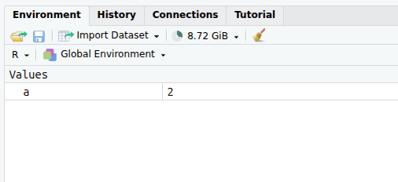{fig-align="center"}
:::

## Numerical values

Now, create a second variable named `b` with a value of 3. Test if it is equal to a.  

::: {.fragment .fade-in}
```{r}
b <- 3		# create a second variable named b, equals to 3
b == a  	# a is still in R's memory, so we can compare it to b
```

Several tests are available to compare variables : `==` ; `!=` ; `>` ; `<`\
They all return a *boolean* value, either **TRUE** or **FALSE**
:::

::: {.fragment .fade-in}
And again, b appeared in the `Environment` :
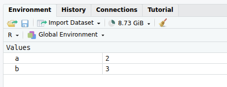{fig-align="center"}
:::
## Numerical values

Store the result of a + b in a new variable. What happens if we change a's value to 7 ?

::: {.fragment .fade-in}
```{r}
a_plus_b <- a + b		# always use explicit names !
a_plus_b

a <- 7 # change a's value
a_plus_b

a_plus_b <- a + b 	# compute the sum to take into account a's changes
print(a_plus_b)	
```

Variables are not updated automatically : you have to re-run operations if one variable changes
:::

# Vectors

## Vectors

Several values can be stored in a vector :

```{r}
measures <-  c(1,10,a,b)    # One vector containing 1, 10 and the values contained in a and b
integers <-  1:10		   # One vector with all integer values from 1 to 10
ducks <-  c("riri", "fifi", "loulou")    # A vector containing character strings
```

::: {.fragment .fade-in .r-fit-text}
The type and number of objects is displayed in the `Environment` :   
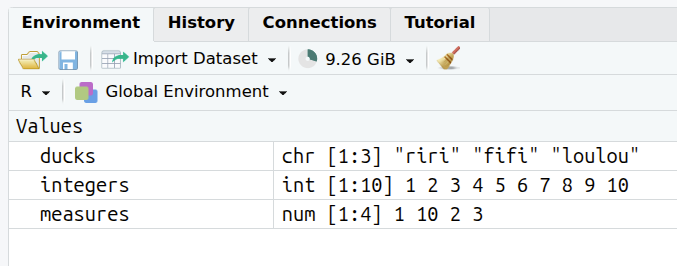{fig-align="center"}
:::

## Vectors

Vectors can only contain **one type** of object !  If we try :
```{r}
test <-  c("riri", 1, 4:6)
class(test)
```
::: {.fragment .fade-in}
all numerical values are converted to text !
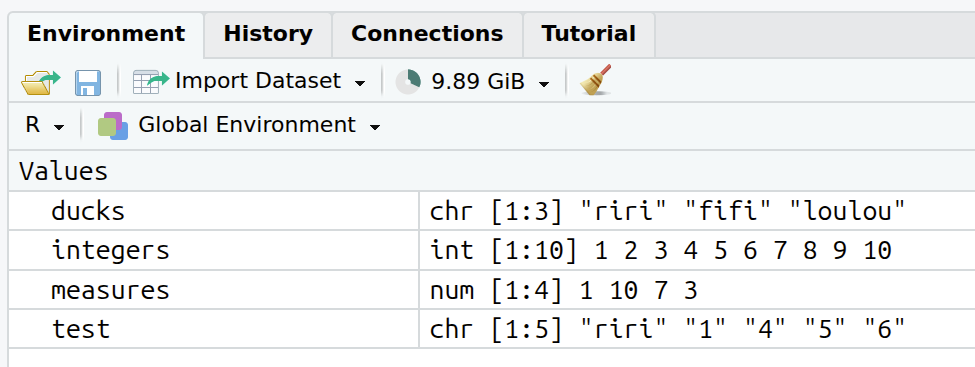{fig-align="center"}
:::

## Vectors

We can compute mathematical operations on vectors :

```{r, eval=F}
measures + a 		# sum of a vector and a numerical value
integers / 2		# dividing a whole vector
ducks / 2		    # does this work ?
```


## Vectors

We can compute mathematical operations on vectors :

```{r, eval=F}
#| code-line-numbers: "1"

measures + a 		# sum of a vector and a numerical value
integers / 2		# dividing a whole vector
ducks / 2		    # does this work ?
```

```{r, echo=F}
measures + a 	
```

## Vectors

We can compute mathematical operations on vectors :

```{r, eval=F}
#| code-line-numbers: "2"

measures + a 		# sum of a vector and a numerical value
integers / 2		# dividing a whole vector
ducks / 2		    # does this work ?
```

```{r, echo=F}
integers / 2
```

## Vectors

We can compute mathematical operations on vectors :

```{r, eval=F}
#| code-line-numbers: "3"

measures + a 		# sum of a vector and a numerical value
integers / 2		# dividing a whole vector
ducks / 2		    # does this work ?
```

[Error in ducks/2 : non-numerical argument given for a binary operator]{.smallcaps style="color: #E34234; font-size: 20pt;"}

Be careful with the type of objects stored in vectors !


## Vectors

`[ ]` can be used to access elements of a vector, using *indexes* :

```{r}
integers[8]		
```

::: {.fragment .fade-in}
Can you change the first value of `measures` to *12* ?
:::

::: {.fragment .fade-in}
```{r}
measures[1] <- 12		
measures
```
:::

## Vectors

Using `c()`, we can add new values to a vector :

```{r}
measures <- c(measures, 9, 8)
measures
```

`c` means `concatenate`

## Vectors

Some values can be empty : R will use `NA` as their value

```{r}
measures[4] <- NA
measures
```

:::{.callout-warning}
Objects with missing values might raise unexpected behaviors
:::

# Lists

## Lists

Lists are another way to store values. They can be created using `list()` function :

```{r}
empty <- list()  # Create an empty list
groceries <- list("banana"=2,"apple"=5,"kiwi"=8) # a list of fruits
unnamed <- list(2,5,8) # a list of unnamed numbers
vrac <- list("A"=1:4,"B"=c(0,1),"C"="hey") # a list with multiple class of objects !
```

::: {.fragment .fade-in}   
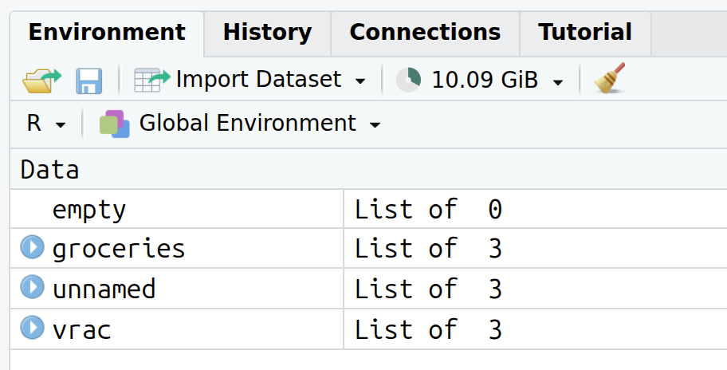  
:::

## Lists

Lists are another way to store values. They can be created using `list()` function :

```{r}
empty <- list()  # Create an empty list
groceries <- list("banana"=2,"apple"=5,"kiwi"=8) # a list of fruits
unnamed <- list(2,5,8) # a list of unnamed numbers
vrac <- list("A"=1:4,"B"=c(0,1),"C"="hey") # a list with multiple class of objects !
```

::::: {.columns}
:::: {.column width="40%"}
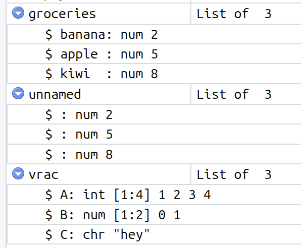{width="400" }
::::
:::: {.column width="60%"}
:::{style="font-size: 23pt;"}
-   They contain several objects called `elements`
-   Those elements can have different classes of objects : numerical values, vectors, characters, other lists...
-   Elements are a combination of a name, called a `key`, and a `value`
-   Names can be empty
:::
::::
:::::

## Lists

To access an `element` of a list, this time use `[[ ]]` and either its index (position of the element in the list) or its name :

```{r}
groceries[["banana"]] # Access the value stored under banana name  
groceries[[1]]  # Access the value of the first groceries element (banana)
```

::: {.fragment .fade-in .r-fit-text}
If an element is already named, you can use `$` to access it directly :

```{r}
groceries$banana          # Access the value stored under banana name 
```
:::

## Lists
:::{.r-fit-text}
Try to access an element of the list `unnamed` with `$` : what happens ?
:::
::: {.fragment .fade-in}
```{r}
unnamed$a
```
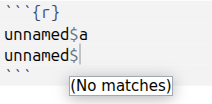{width="280"}  
:::

::::{.callout-tip} 
R auto completion will help you select the right element
::::
## Lists

::::{style="font-size: 25pt;"}
Use `[[ ]]` to add a named element to the list `empty`

::: {.fragment .fade-in fragment-index="1"}
```{r}
empty[["key"]] <- "value" 	# add a named element to the empty list
```
:::

Use `[[ ]]` to add an unnamed element in the 4th position of the list `empty`

::: {.fragment .fade-in fragment-index="1"}
```{r}
empty[[4]] <- 10 	# add an unnamed element to the 4th position
```

Notice that the list now contains a 2nd and a 3rd element as well : they are unnamed and hold the value `NULL`   
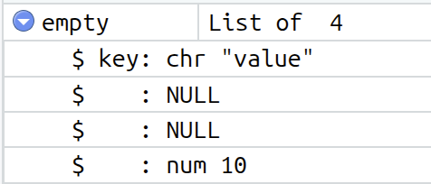  
:::

::::

# Functions

We already saw that R uses functions to do ... almost anything!   
But how to use them ?

## Functions

A function has :  

::: {.fragment .fade-in}  
-   A `name`, to execute the function or look for help  
::: 
::: {.fragment .fade-in}  
-   One or more `arguments` : some are necessary for the function to run, others have default values
:::
::: {.fragment .fade-in}  
-   An `output` : the result of the computations on the given arguments. With complex functions, this will often be a list
:::

## Functions

For example, look at the help for function `mean`
```{r}
?mean
```

::: {.fragment .fade-in}   
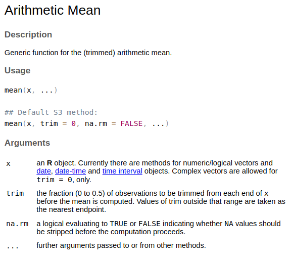  
:::

## Functions

We use `( )` to give the function its `arguments` before running : for mean, a vector of numerical values

::: {.fragment .fade-in}   
```{r}
mean(measures) # compute the mean of measures
mean(x = measures) # same
```
:::

If any of the values is missing, `mean` will return a missing value `NA`. We can use the argument `na.rm` to ignore them :

::: {.fragment .fade-in}   
```{r}
mean(x = measures, na.rm = TRUE) 
```
::: 
## Functions

Arguments can be  :  
- *named* : they can be written in any order   
- *unnamed* : R will expect them in their appearing order  

```{r, eval=F}
mean(x=measures, trim=0, na.rm=TRUE) # OK
mean(na.rm=TRUE, x=measures, trim=0) # OK
mean(measures, 0, TRUE)  # OK
mean(TRUE, measures)  # NOT OK !
mean(measures, TRUE)  # NOT OK !
```

## Functions

Arguments can be  :  
- *named* : they can be written in any order   
- *unnamed* : R will expect them in their appearing order  

```{r, eval=F}
#| code-line-numbers: "4-5"

mean(x=measures, trim=0, na.rm=TRUE) # OK
mean(na.rm=TRUE, x=measures, trim=0) # OK
mean(measures, 0, TRUE)  # OK
mean(TRUE, measures)  # NOT OK !
mean(measures, TRUE)  # NOT OK !
```

[Erreur dans mean.default(measures, TRUE) :    
'trim' doit être une valeur numérique de longueur un]{.smallcaps style="color: #E34234; font-size: 20pt;"}


## Functions

We can store the output of a function in a variable as well :

```{r}
mean_measures <- mean(x=measures, na.rm=TRUE)
```

::: {.callout-warning}   
**Variable != Arguments**    
`mean_measures` is now stored in the environment, but `x` and `na.rm` are not : they where only given to the mean function  
:::

## Functions

Finally, you can create your own functions by defining its name, arguments, output and the list of operations needed to compute the results you want

```{r}
square <- function(x) {
  # as many lines as you want here !
  output = x * x
  return(output)
}
```

::: {.callout-tip}   
This can be useful if you need to repeat the same computations several times, or if you need to modify some existing functions
:::

# Data frames

Now it's time to manipulate some real data !

## What's a data frame ?

A two-dimensional way of storing information : 

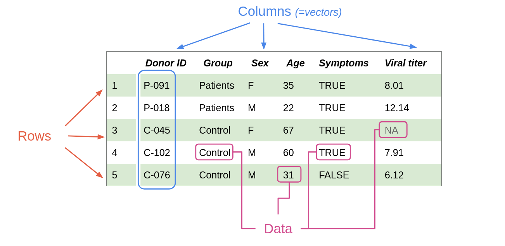{fig-align="center"}

:::{.r-fit-text}
Most biology data are **tabular** : one row per observation (a gene, sample ...) and one column per feature (position, group, measured expression, ...).   
:::

## Our example   

:::{style="font-size: 22pt;"}
We'll use the file `annot_GRCH38_reduced.csv`, an extract of 2000 rows from Ensembl human genome (GRCh38). One row describes a gene :
:::

:::{.r-fit-text}
| Column name   | What's inside                                                        |
|---------------|----------------------------------------------------------------------|
| `ensgene`     | Ensembl ID (eg `ENSG00000149489`), identifies a gene                 |
| `entrez`      | NCBI Entrez Gene ID (sometimes missing, sometimes several are given) |
| `symbol`      | official gene symbok (eg. `ROM1`), sometimes missing                 |
| `chr`         | chromosom (or contig / patch)                                        |
| `start`, `end`| end and start position within the chromosome (base pairs)            |
| `strand`      | chromosome strand : `1` (+) or `-1` (−)                              |
| `biotype`     | type of gene (`protein_coding`, `lncRNA`, `miRNA`, pseudogene…)      |
| `description` | a short description of the gene (text)                               |
:::

## Import the annotation file

We'll use `read.table` function. What are its arguments ?

:::{.fragment}
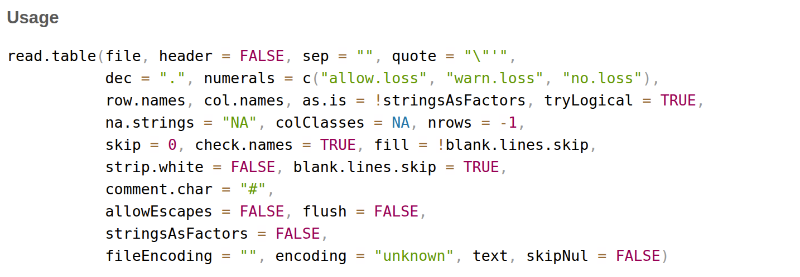
:::

## Import the annotation file

We'll use `read.table` function. What are its arguments ?

```{r}
annotation_data <- read.table(file = "annot_GRCH38_reduced.csv", header = TRUE, 
                              sep = ",", dec = ".", quote='"')
```

:::{.callout-tip}
Look at the annotation file first to know what to give to the `read.table` function
:::

## Inspect `annotation_data` 

All the content from the annotation file is now in a data-frame. Try the following functions :

```{r}
dim(annotation_data)      # rows x columns
nrow(annotation_data)     # number of genes
ncol(annotation_data)     # number of features
names(annotation_data)    # column names
```

## Inspect `annotation_data`

`str()` is the first function to use on a new dataset : it'll give you the name and type of each column, along with an overview of the values within.

```{r str}
str(annotation_data)
```

## Inspect `annotation_data`

Functions `head()` and `tail()` also exist in R ! 

```{r head, eval=F}
head(annotation_data)         # 6 first rows
tail(annotation_data, n = 3)  # 3 last rows
```

In RStudio, you cans also open an interactive view with `View(annotation_data)` or by clicking on the object in your environment, or directly on the file.

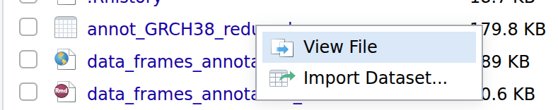{.absolute width="600"}

## Inspect `annotation_data`

:::{.r-fit-text}
Lastly, the `summary` function will make a quick summary of each column :
:::

```{r summary}
summary(annotation_data)
```

## Access data within data frames

:::{style="font-size: 24pt;"}
Since columns are vectors, and the data frames contain several of them, we can access data the same ways we did vectors and list ! How would you extract a column ?
:::

:::{.fragment}
```{r col, eval=F}
# getting a column by name
annotation_data$symbol       
annotation_data[["biotype"]]
annotation_data[, "start"]  
```
:::

## Access data within data frames

[The general syntax is **`data[rows, columns]`**]{style="font-size:24pt;"}

[get first row (gene ROM1)]{.smallcaps style="color: #74C476; font-size:24pt;"} 

:::{.fragment}
```{r}
annotation_data[1, ]  
```
:::

[get the symbol of ROM1]{.smallcaps style="color: #74C476; font-size:24pt;"}  

:::{.fragment}
```{r}
annotation_data[1, "symbol"]    
```
:::

[a bloc : get 3 first rows of both symbol and chr]{.smallcaps style="color: #74C476; font-size:24pt;"}  

:::{.fragment}
```{r}
annotation_data[1:3, c("symbol", "chr")]     
```
:::

## Access data within data frames

Rows actually have names : by default it's their number

```{r rownames}
head(rownames(annotation_data))
annotation_data["1", c("ensgene", "symbol", "description")]   # using row name " "
```

:::{.callout-tip}
We could replace row names by a more explicit value : this requires some unique identifier (no duplicates, no missing values)
:::

## Access data within data frames

Since each column is a vector, you can apply regular vector functions on them : 

```{r vec}
mean(annotation_data$end - annotation_data$start)
range(annotation_data$start)
length(unique(annotation_data$biotype))
```

## Column types & factors

:::{style="font-size: 23pt;"}
Earlier we noticed `strand` contained `1` or `-1`, but calculate its mean does not make biological sense, it's a category ! In R, this specific type is called a `factor`:
:::

```{r strand}
annotation_data$strand <- factor(annotation_data$strand, levels = c(1, -1), labels = c("+", "-"))
```

:::{.fragment}
```{r}
#| code-line-numbers: "|13"

table(annotation_data$strand)
str(annotation_data)
```
:::

## Column types & factors

What other columns should be converted to factors ? 

:::{.fragment}
```{r}
annotation_data$biotype <- factor(annotation_data$biotype)
nlevels(annotation_data$biotype)
```
:::

## Add new columns

We can create a new column with `<-` by giving it a name and affecting a value, to all rows at once. For example, how could we compute **gene length** ?  

:::{.fragment}
```{r newcol}
annotation_data$length <- annotation_data$end - annotation_data$start + 1   # locus length (bp)
annotation_data$log10_length <- log10(annotation_data$length)

head(annotation_data[, c("symbol", "start", "end", "length")])
summary(annotation_data$length)
```
:::

## Filtering rows

:::{style="font-size: 24pt;"}
The haRd way : we build a mask (= a vector of `TRUE`/`FALSE` values, one per row) and use it with `[ , ]` to select rows with `TRUE` values :
:::

```{r}
head(annotation_data$biotype == "protein_coding", 10)   # overview : one TRUE/FALSE per gene
```

:::{.fragment}
```{r filter2}
coding <- annotation_data[annotation_data$biotype == "protein_coding", ]
nrow(coding)
```
::: 

## Filtering rows

Select genes from chromosome 17. How many are they ?  

:::{.fragment}
```{r chr17}
chr17 <- annotation_data[annotation_data$chr == "17", ]
nrow(chr17)
```
:::

## Filtering rows

:::{style="font-size: 24pt;"}
Logical operators can be used : `&` (and), `|` (or), `!` (negate), `%in%` (exist in).
:::

:::{.fragment}
```{r}
# coding genes for all chromosomes except 21
annotation_data[annotation_data$biotype == "protein_coding" & annotation_data$chr !=21,
      c("symbol", "start", "end", "length")][1:8, ]
```
:::

:::{.fragment}
```{r}
# petits ARN non codants
small_rna <- annotation_data[annotation_data$biotype %in% c("miRNA", "snRNA", "snoRNA"), ]
table(droplevels(small_rna$biotype))
```

`droplevels()` removes factor levels that became empty after filtering
:::

## Text search : `grepl()`

`grepl(pattern, string)` returns `TRUE` of a pattern is detected within a given string (character)

```{r grepl}
# protein coding kinases
kinases <- annotation_data[grepl("kinase", annotation_data$description) & annotation_data$biotype == "protein_coding", c("symbol", "chr", "description")]
nrow(kinases)
head(kinases, 8)
```


## Using `subset`

:::{.r-fit-text}
to avoid repeating `annotation_data$` every time we can use `subset`
:::

```{r subset}
subset(annotation_data, 
       biotype == "protein_coding" & length > 400000, 
       select = c(symbol, chr, length, description))
```

## Missing values & empty strings

Biological are rarely complete. Empty cells are often : 

:::{style="font-size: 26pt;"}
[1. Missing values `NA` : like in `entrez` column]{style="color: #000000;"}     
[2. Empty strings `""` : for example in `symbol`]{style="color: #000000;"}      
[3. Something else : sometimes we see  `"N/A"`, `"missing"` ...]{style="color: #000000;"}     
:::

## Missing values & empty strings

Biological are rarely complete. Empty cells are often :   

:::{style="font-size: 26pt;"}
[1. Missing values `NA` : like in `entrez` column  ]{style="color: #74C476;"}    
[2. Empty strings `""` : for example in `symbol`  ]{style="color: #E34234;"}    
[3. Something else : sometimes we see  `"N/A"`, `"missing"` ...  ]{style="color: #E34234;"}   
:::  

[R does not recognise them as `NA` !]{.smallcaps style="color: #E34234;"}

```{r na1}
sum(is.na(annotation_data$entrez))      # number of NA in entrez column
sum(annotation_data$symbol == "")       # number of missing symbols
colSums(is.na(annotation_data))         # NA per column
```

## Missing values & empty strings
:::{.r-fit-text}
It's usually best to convert all true missing data to true NA values : 
:::
```{r na2}
annotation_data$symbol[annotation_data$symbol == ""] <- NA
colSums(is.na(annotation_data))
```
:::{.r-fit-text}
Now we can see how many coding genes have missing symbols : 
:::
```{r na3}
annotation_data[annotation_data$biotype == "protein_coding" & is.na(annotation_data$entrez),
      c("ensgene", "symbol", "description")]
```

## Ordering values

`order()` will return the indexes (row number) of rows according to a given condition :

```{r order1}
# Top 5 longest coding genes
coding <- annotation_data[annotation_data$biotype == "protein_coding", ]
top5 <- coding[order(coding$length, decreasing = TRUE), ]
top5[1:5, c("symbol", "chr", "length", "description")]
```

## Ordering values

Try to get the 5 first genes of chromosome 1 : 

:::{.fragment fragment-index="3"}
```{r order2}
chr1 <- annotation_data[annotation_data$chr == "1", ]
chr1 <- chr1[order(chr1$start), ]
chr1[1:5, c("symbol", "start", "end", "strand")]
```
::: 

:::{.fragment .callout-tip fragment-index="2"}
filter chr1 then order by starting position, then select top 5
:::


## Visualisation

```{r table}
coding_nuc <- annotation_data[annotation_data$biotype == "protein_coding", ]
n_per_chr <- table(coding_nuc$chr)

barplot(n_per_chr, las = 2, col = "steelblue", main = "Coding genes per chromosome (2000 genes sample)", ylab = "Number of genes de gènes")
```

## Visualisation

```{r boxplot}
main_types <- c("protein_coding", "lncRNA", "processed_pseudogene", "miRNA", "snRNA")
sel <- droplevels(annotation_data[annotation_data$biotype %in% main_types, ])

boxplot(log10_length ~ biotype, data = sel, las = 2,
        col = "lightgrey", xlab = "", ylab = "log10(length in bp)",
        main = "Gene length according to biotype")
```

# Take home message

R is a great tool with (almost) [**limitless possibilities**]{style="color: #74C476"}. A lot of ressources are available on each area of research. But remember to always [**define & understand your needs**]{style="color: #E34234"} to select the best R function to help you.

**Rstudio Cheatsheets  :**     
[https://rstudio.com/resources/cheatsheets/](https://rstudio.com/resources/cheatsheets/){.external target="_blank"}

**Packages from tidyverse :**   
[https://tidyverse.org/](https://tidyverse.org/){.external target="_blank"}


## To go further

A set of packages to simplify data handling :

- **mutate** : to modify / add columns
- **select** : extract specific columns 
- **filter** : chose rows according to criteria
- **merge** : compile data frames together
- ...

```{r, eval=F}
annotation_data %>% 
  mutate(gene_length=pos_end-pos_start) %>% 
  select(gene_length<1200) %>% 
  merge(count_data)
```

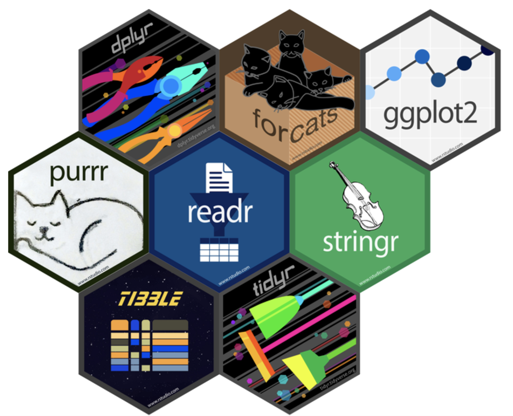{.absolute top="100" left="750" width="300" }
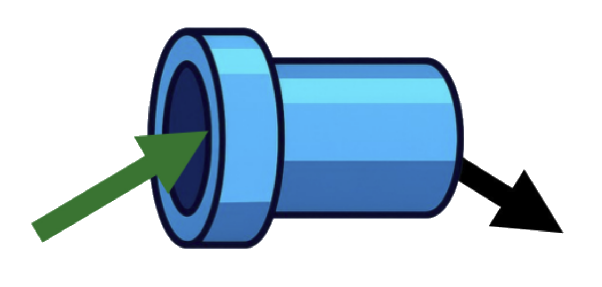{.absolute bottom="45" left="700" width="200" }

## Ways to import files

A **lot** of different functions to import data from files : read.table, read.csv, read.csv2, read.tsv, read.delim ...

and even specific packages :   
- `vroom` to import big data faster    
- `readxl`, `openxlsx` to read excel files  
- `readRDS` to read R-files  
- `load` to import a whole R environment   

{.absolute top="100" left="950" width="80" }
{.absolute top="200" left="950" width="80" }
{.absolute top="300" left="950" width="80" }

:::{.callout-tip}
Do not hesitate to search "How to open ... file in R ?" 
:::

# Memos for later

## Manipulate basic objects 

:::{.r-fit-text}
| Symbol    | Goal                  | Examples       |
|-----------|-----------------------|----------------|
| `=` or `<-` or `->` | assign a `value` to a `variable` or an `argument` | a `<-` 10 or read.table(file `=` "file.txt") |
| `( )`     | to give `arguments` to a function | mean`(`x = c`(`10,6,8,2`))` |
| `[ ]`     | get a value from a vector | measures`[`1`]` or measures`[`2:8`]` or measures`[`c(3,6,4)`]` |
| `[[ ]]` or `$` |  get an element from a list | groceries`$`banana or groceries`[[`"banana"`]]` or groceries`[[`1`]]` | 
| `[ , ]` ou `$` | extract elements from a data-frame | annotation`$`geneID or annotation`[`1:5`,`geneID`]` |
:::

## Good practices

:::{.r-fit-text}
| To                        | Do this              | Avoid this         |
|-------------------------  |----------------------|--------------------|
| Clean your environment    | `rm(list = ls())`    | mixing-up variables| 
| Use explicit names        | expression_data, annotation, groceries_list | dat, var1, dfslkgj  |
| Use NA values when needed | empty cells in data files to get `NA` | "missing", "N/A", ...  |
| Use comments              | with `#`, using lines, stars ...       | obscure functions, 100+ lines without comment |
| Have readable scripts     | use spaces, skip lines, add blocks ... | all commands in one block  |
:::
[Tidyverse guidelines](https://style.tidyverse.org/syntax.html){.external target="_blank"}

## Logical operators

:::{style="font-size:26pt;"}  
| Operator | Description           | Example        | Result    |
|----------|-----------------------|----------------|-----------|
| `==`     | Equal to              | `5 == 3`       | `FALSE`   |
| `!=`     | Not equal to          | `5 != 3`       | `TRUE`    |
| `>`      | Greater than          | `5 > 3`        | `TRUE`    |  
| `<`      | Less than             | `5 < 3`        | `FALSE`   |
| `>=`     | Greater or equal      | `5 >= 5`       | `TRUE`    |
| `<=`     | Less or equal         | `5 <= 3`       | `FALSE`   |
| `&`      | Element-wise AND      | `TRUE & FALSE` | `FALSE`   |
| `|`      | Element-wise OR       | `TRUE | FALSE` | `TRUE`    |
| `!`      | NOT                   | `!TRUE`        | `FALSE`   |  
:::

## Aritmetic operators  

:::{style="font-size:28pt;"}  
| Operator | Description     | Example   | Result |
|----------|-----------------|-----------|--------|
| `+`      | Addition         | `5 + 3`   | `8`    |
| `-`      | Subtraction      | `5 - 3`   | `2`    |
| `*`      | Multiplication   | `5 * 3`   | `15`   |
| `/`      | Division         | `5 / 2`   | `2.5`  |
| `^`      | Exponentiation   | `2 ^ 3`   | `8`    |
| `%%`     | Modulus          | `5 %% 2`  | `1`    |
| `%/%`    | Integer Division | `5 %/% 2` | `2`    |   
:::  

## Data frames

:::{style="font-size:20pt;"}  
| What I want to do                | Example                                               |  
|----------------------------------|-------------------------------------------------------|  
| import a .csv file               | `read.csv("fichier.csv")`                             |  
| inspect                          | `str()`, `head()`, `summary()`, `dim()`               |  
| get a column                     | `df$col`, `df[["col"]]`                               |  
| row / columns                    | `df[row, col]`                                        |  
| new column                       | `df$new <- ...`                                       |  
| filter                           | `df[condition, ]`, `subset()`                         |  
| order                            | `df[order(df$col), ]`                                 |  
| count                            | `table()`                                             |  
| mising valuesntes                | `is.na()`                                             |  
| duplicated values                | `duplicated()`, `unique()`                            |  
| export                           | `write.csv(df, "out.csv", row.names = FALSE)`         |   
:::
