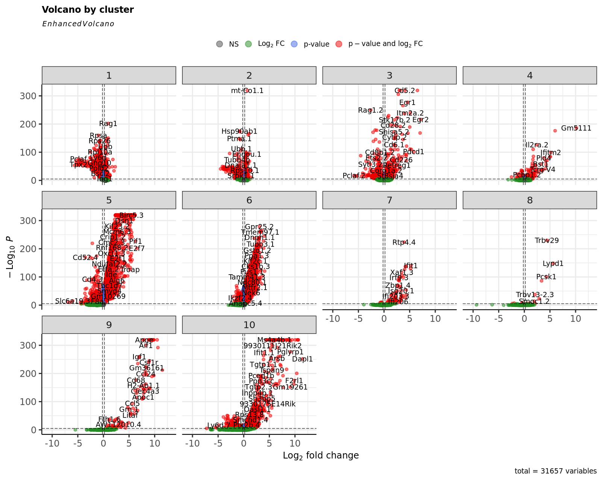
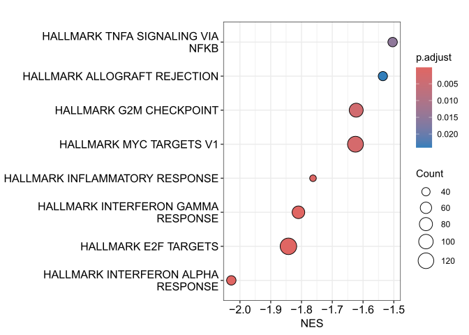
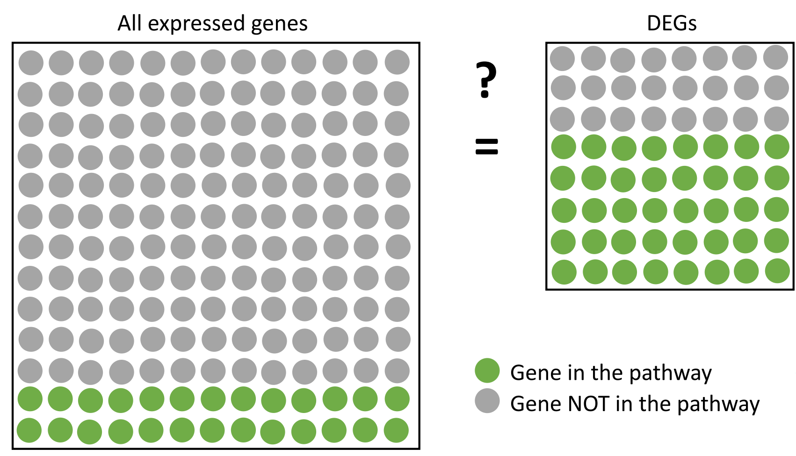
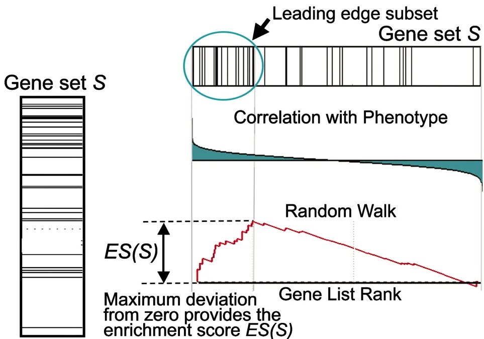

From Volcano Plot
{fig-align="left" fig-cap-location="top" width=75%}

---

To enrichment results
<br>
{fig-align="right" fig-cap-location="top"}

. . .

The principle of **enrichment analyses** is to try to **summarize a list of genes** using gene sets linked to **known biological information**.

## Workflow

:::: {.columns}

::: {.column width="60%" .diagram}

```{mermaid}
flowchart TB
  A[Genes of interest]
  A -->B{Enrichment Test}
  C[Knowledge database] --> B
  B --> D[Enrichment results]
```

:::

::: {.column width="40%" .fragment .text}

You need 3 elements to run an enrichment analyses :

- genes of interest (*ex: DEG*)
- a knowledge database (*ex: Gene Ontology*)
- an enrichment test (*ex: GSEA*)

The different elements of the workflow are defined based on the other ones. 

:::

::::

## Over Representation Analyses

[The Over-Representation Analyses aims to compare the proportion of genes belonging to a function in your genes of interest compared to a background.]{.text}

```{mermaid}
flowchart LR
  subgraph GENES OF INTEREST
    volcano@{ img: "_imgs/volcano_select.png", label: "Selected genes", h: 120, constraint: "on"}
  end
  subgraph KNOWLEDGE DATABASE
    db@{ img: "_imgs/databases.png", label: "Any list of genes", h: 120, constraint: "on" }
  end
  subgraph ENRICHMENT TEST
    test{Fisher’s exact tests}
  end
  volcano --> test
  db --> test
```

## Over Representation Analyses

[The Over-Representation Analyses aims to compare the proportion of genes belonging to a function in your genes of interest compared to a background.]{.text}

{fig-align="center" width=67%}

## Over Representation Analyses

[The Over-Representation Analyses aims to compare the proportion of genes belonging to a function in your genes of interest compared to a background.]{.text}

```{mermaid}
%%| fig-align: center
flowchart LR
  subgraph GENES OF INTEREST
    volcano@{ img: "_imgs/volcano_select.png", label: "Selected genes", h: 120, constraint: "on"}
  end
  subgraph KNOWLEDGE DATABASE
    db@{ img: "_imgs/databases.png", label: "Any list of genes", h: 120, constraint: "on" }
  end
  subgraph ENRICHMENT TEST
    test{Fisher’s exact tests}
  end
  subgraph ENRICHMENT RESULTS
    FDR@{ img: "_imgs/ORA_results.png", label: "Any list of genes", h: 120, constraint: "on" }
  end
  volcano --> test
  db --> test
  test --> FDR
```

## Gene Set Enrichment Analyses (GSEA)

[Gene Set Enrichment Analyses consist on **performing a rank test** on you gene list **not filtered** and **ordered**.]{.text}

```{mermaid}
flowchart LR
  subgraph GENES OF INTEREST
    volcano@{ img: "_imgs/ranked.png", label: "Ranked gene list", h: 120, constraint: "on"}
  end
  subgraph KNOWLEDGE DATABASE
    db@{ img: "_imgs/databases.png", label: "Any list of genes", h: 120, constraint: "on" }
  end
  subgraph ENRICHMENT TEST
    test{Kolmogorov–Smirnov-like<br>test}
  end
  volcano --> test
  db --> test
```

## Gene Set Enrichment Analyses (GSEA)

[Gene Set Enrichment Analyses consist on **performing a rank test** on you gene list **not filtered** and **ordered**.]{.text}

{fig-align="center" width=60%}

## Gene Set Enrichment Analyses (GSEA)

[Gene Set Enrichment Analyses consist on **performing a rank test** on you gene list **not filtered** and **ordered**.]{.text}

```{mermaid}
%%| fig-align: center
flowchart LR
  subgraph GENES OF INTEREST
    volcano@{ img: "_imgs/ranked.png", label: "Ranked gene list", h: 120, constraint: "on"}
  end
  subgraph KNOWLEDGE DATABASE
    db@{ img: "_imgs/databases.png", label: "Any list of genes", h: 120, constraint: "on" }
  end
  subgraph ENRICHMENT TEST
    test{Kolmogorov–Smirnov-like<br>test}
  end
  subgraph ENRICHMENT RESULTS
    FDR@{ img: "_imgs/GSEA_results.png", label: "Any list of genes", h: 120, constraint: "on" }
  end
  volcano --> test
  db --> test
  test --> FDR
```

## Summary

```{mermaid}
flowchart TB
  A[Genes of interest]
  A -->B[Enrichment Test]
  C[Knowledge database] --> B
  B --> D{Enrichment results}
```

## Summary

| Test | Input  | (some) Output |
|:-----|:------:|-------:|
| ORA  | genes selected by cut-off   | FDR, ratio of genes, genes in gene list and gene set |
| GSEA | all genes ranked by a measurement | FDR, enrichment score, leading edge genes |

. . .

Other enrichment tests exist and could also be used depending on the input data (database information and gene list format)

## Limitations

::: {.text}
- Highly sensitive to database content (! database update)
- Small gene sets tend to be less significant that large gene sets
- Independence assumption on genes and on gene sets
- The gene set does not adapt to your cell type or condition
- Not all the organisms have the same level of knowledge
- A lot of genes are not studied
:::

## References

**Tools** :

- [ClusterProfiler](https://yulab-smu.top/biomedical-knowledge-mining-book/index.html)
- [AUCell](https://www.bioconductor.org/packages//3.18/bioc/vignettes/AUCell/inst/doc/AUCell.html)

**Enrichment Test** :

- [ORA](https://doi.org/10.1186/1471-2105-14-128)
- [GSEA](https://www.pnas.org/doi/full/10.1073/pnas.0506580102)
- [Interpreting omics data with pathway enrichment analysis](https://www.cell.com/trends/genetics/fulltext/S0168-9525(23)00018-5)
- [Robustness and applicability of transcription factor and pathway analysis tools on single-cell RNA-seq data](https://pmc.ncbi.nlm.nih.gov/articles/PMC7017576/)

## References

**Best practices**:

- [hbc training](https://hbctraining.github.io/Pseudobulk-for-scRNAseq/lessons/07_functional_analysis_pseudobulk.html)
- [single-cell best practices](https://www.sc-best-practices.org/conditions/gsea-pathway/)
