<!-- ADDITIONAL CODES / HACKS -->

<!-- CSS code to center the QMD title -->
<style>
#title-block-header .title {
  text-align: center;
}
</style>


<!-- CSS code to center the imported images -->
<style>
.center-image {
  display: block;
  margin-left: auto;
  margin-right: auto;
}
</style>


<!-- CSS code to displace the clipboard copy button slightly to the left so that it does not overlap code annotations -->
<style>
.code-with-filename .code-copy-button {
  right: 2.5rem !important;
}
</style>


<!-- HTML code to force table borders -->
```{=html}
<style>
td, th {
  border: 1px solid black;
  border-collapse: collapse;
}
</style>
```


<!-- BODY -->


------------------------------------------------------------------------

------------------------------------------------------------------------

{.center-image}

------------------------------------------------------------------------

------------------------------------------------------------------------

<br>

# PREAMBLE

## Purpose of this session

<br>

This file describes the theory inside R/Rstudio to perform data
analysis, especially the **first part** of the **single cell RNAseq**
data analysis training course for the **EBA3I 2026**, covering these
steps :

-   **Using Rstudio**
-   **Speaking R**
-   **Think about what you want with which tools?**

<br>

------------------------------------------------------------------------

------------------------------------------------------------------------

<br>
<br>

# Start Rstudio

## First sight


<center>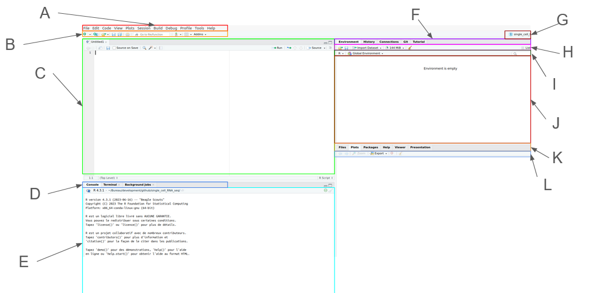</center>

-   A : global functions tools
-   B : Quick-launch functions 1
-   C : Script pane
-   D : Console pane
-   E : Monitoring console
-   F : Work folder
-   G : Work session
-   H : Quick-launch function 2
-   I : Environment console pane
-   J : Environment monitoring console
-   K : Multi-widgets interface
-   L : Quick-launch function 3

## The script pane (C)

<br>

This is where you write your R scripts. This also accepts other
languages (e.g. bash, python, …), but R Studio shines for its R
integration.

<center>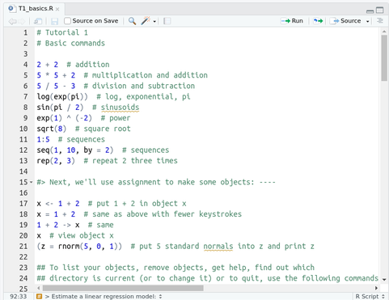</center>

<br> 

**Please, please** ! Write your commands in the Script pane, then execute
them by hitting CTRL + Enter. This is very much like your lab-workbook:
the history pane only keeps a limited number of function in memory while
this script keeps your commands in a file on your disk. You may share
it, edit it, comment it, etc.

<br> 


## Console Pane (D + E)

<br>

<center>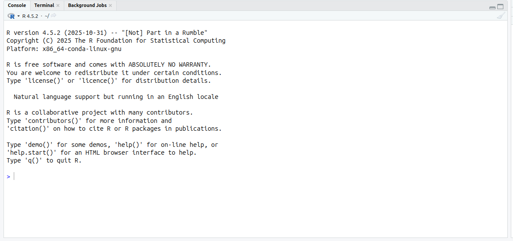</center>

This is a standard R console. Open your bash terminal, enter the
following command: R, and you will get the same console.

::: {.callout-note}      
Here, we are in a RStudio session powered by the IFB. Your local RStudio might differ: the version of R, the list of available packages, etc. On your local machine, RStudio console will match with the R available in your terminal.
:::


Let’s try to enter the command `print()`:

```{r class.source="fold-hide", attr.output='.details summary="Output"'}
#| label: first_function
#| filename: first_function

print("Hello World")
```


<center>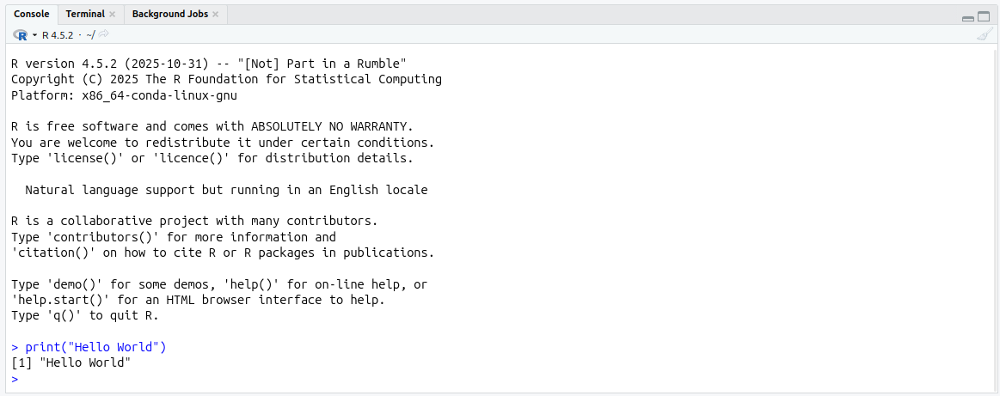</center>

We just used a function, called `print`. A **function** is a R command that is followed by parenthesis `(` and `)`.
Between these parenthesis, we enter **arguments.** 
This function tries to print on screen everything provided between parenthesis ( and ). In this
particular case, we gave the character string "Hello World", and the
function *print* successfully printed it on screen !

<br>


::: {.callout-note}  
Info: There is a syntax coloration, there is a good autocompletion and parameter suggestion. If I ever see anyone writing down a complete command without typing the tabulation key, then I’ll have to steal their dessert. And I’m always hungry enough for desserts.
:::

<center>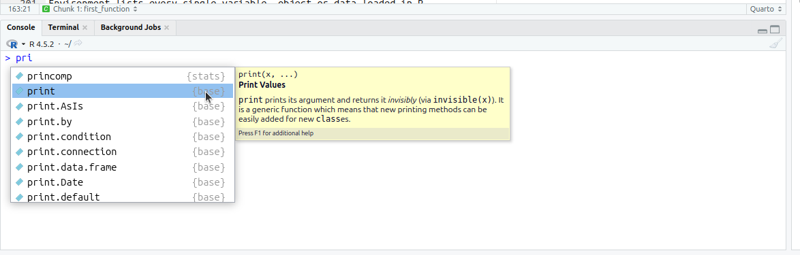</center>

<center>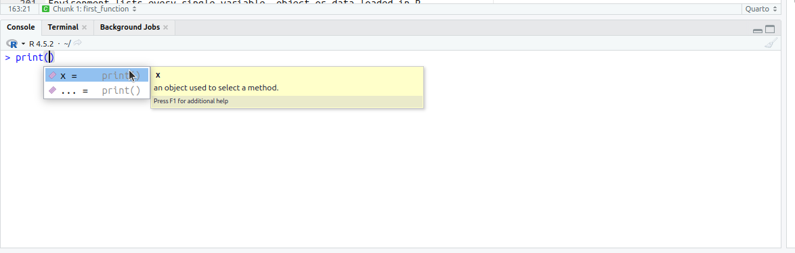</center>


<br>


Now click on Session -\> *Save Workspace as* and save the current work
space. 

<center>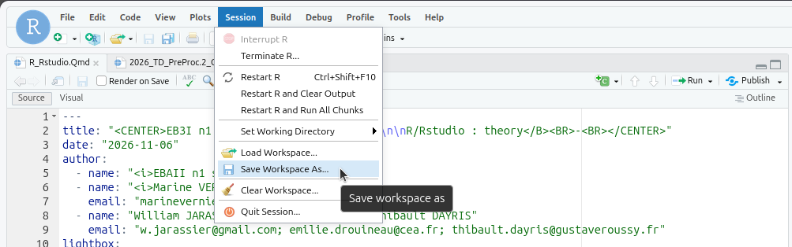</center>


What happened in the R console pane? 

<center>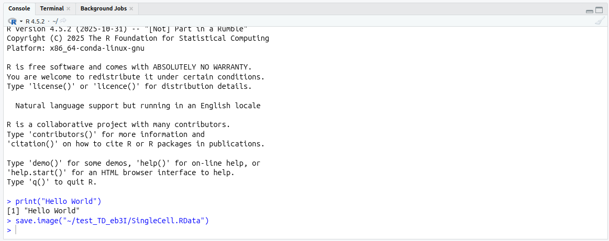</center>

You saw it! A command has
been automatically written. For me, it is:

```{r}
#| label: save_workspace_as
#| filename: save_workspace_as

save.image("~/test_TD_eb3I/SingleCell.RData")
```

<br>

## Environment/History/Connection/Tutorial (F + G + H + I + J)

<br>

<center>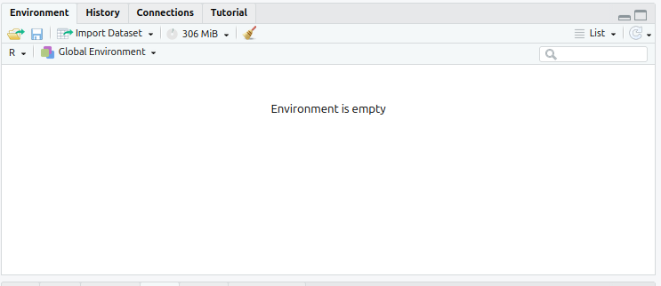</center>

<br>

This pane has four tabs: Environment, History, Connections and Tutorial.

<br>

### Environment

Environment lists every single variable, object or data loaded in R.
This includes only what you typed yourself and does not include
environment variables. Example: in you console pane, enter the following
command:

```{r}
#| label: first_variable
#| filename: first_variable

zero <- 0  # May also be written zero = 0
```

What happened in the Environment pane ? You’re right: a variable is now
available!

<center>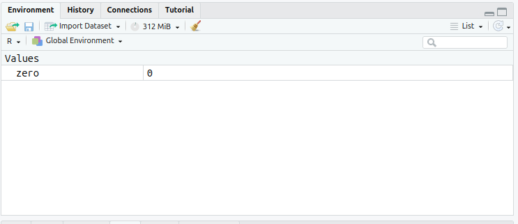</center>


When a more complex object is declared in your work space, then some
general information may be available. Example:

```{r}
#| label: small_table
#| filename: small_table

small_table <- data.frame("col_a"=c(1, 3), "col_b"=c(2, 4))
```

<center>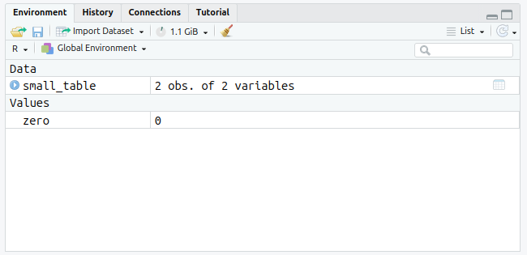</center>

<br>

You can now see the dataframe. Click on it to have a preview of the data it
contains, then click on the light-blue arrow to have a deeper insight of
its content:

<center>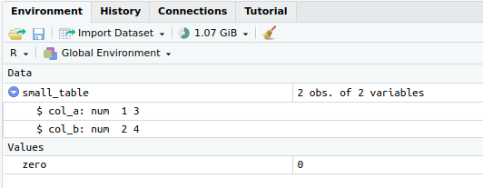</center>

<br>


<center></center>

<br>

Now click on Session -\> *Clear Work space*: and see your work disappear.
This action cannot be undone. While it is useful to clear one work space
from time to time in order to avoid name space collisions, it is better
to save your work space before.

<center>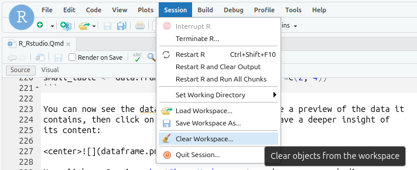</center>

<br>

<center>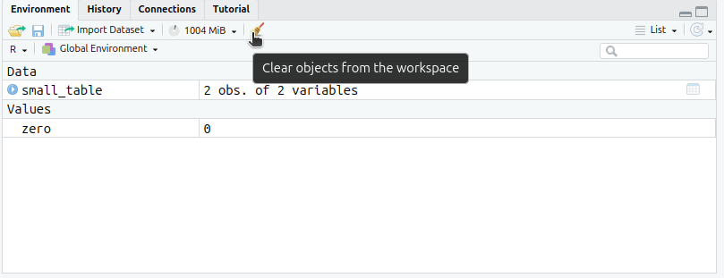</center>

Alternatively, it can be performed by command line:

```{r}
#| label: clear_work_space
#| filename: clear_work_space

rm(list = ls())
```

### History

<center>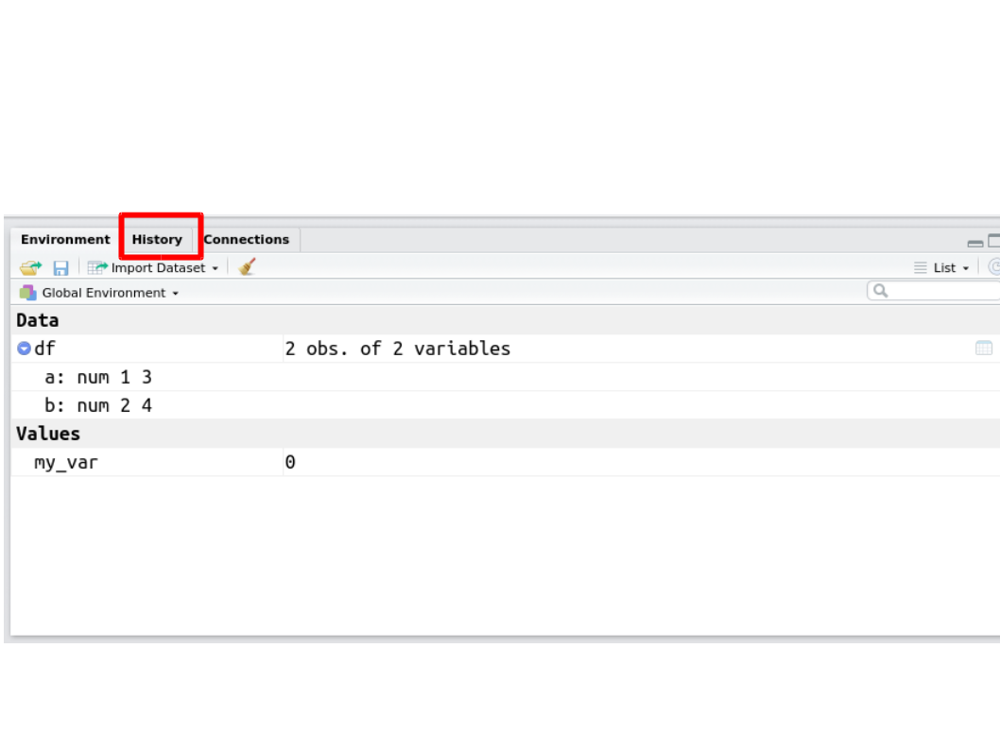</center>

<center>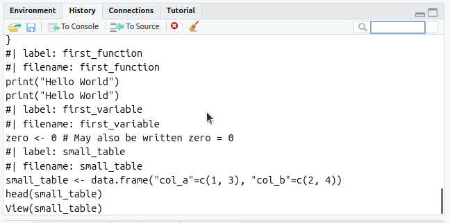</center>

While you test and search in the console,
your history keeps a track of each command line you entered. This will
definitely help you to build your scripts, to pass your command lines to
your coworkers, and to revert possible unfortunate errors.

Each history is related to a session. You may see many commands in your
history. Some of them are not even listed in your console. R Studio writes
in there every command, even the ones that were masked for the sake
of your eyes (knitting commands, display commands, help commands, etc.)

Your history has a size limit. This limit is set by an environment
variable called R_HISTSIZE (standing for: R History Size). It may be
checked with the function `Sys.getenv()` and set with the function
`Sys.setenv()`:

<br>

## The Help/Plot/Packages/File pane (K + L)

### Help

<br>

This is maybe the most important pane of your R Studio. THIS is the
difference between R Studio and another code editor. Search for any
function here and not on the internet. This pane shows you the available
help for YOUR version of R, YOUR version of a given package.

Different versions may have different default parameters and interfaces.
Please be sure over the internet, to copy and type commands that are not
harmfull for your computer.

<center>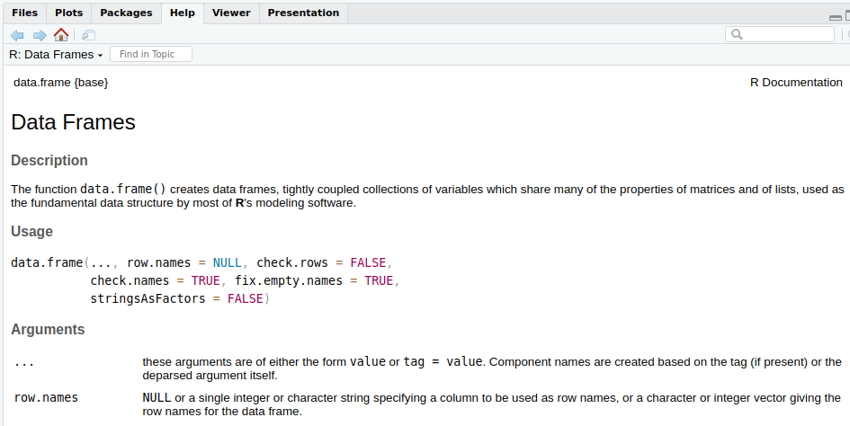</center>

<br>

#### How find help for one object ?

```{r}
#| label: help
#| filename: help

?data.frame # or help(data.frame)
```

```{r}
#| label: help2
#| filename: help2

??data.frame # or help.search("data.frame")
```

<br>

### Files pane

<br>

Just like any file explorer, we can move across directories, create
folders and file, delete them, etc.

Where am I ?

```{r class.source="fold-hide", attr.output='.details summary="Output"'}
#| label: working_directory
#| filename: working_directory

getwd()
```

Create a directory :

<center>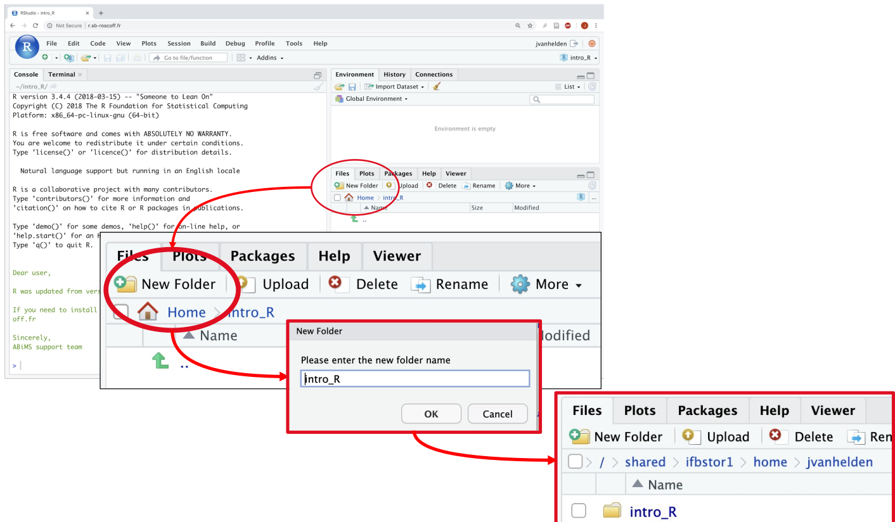</center>

Or use the function `dir.create()`:

```{r}
#| label: create_directory
#| filename: create_directory
#| warning: false

dir.create("~/introR/intro_R")
# or if you want to create recursively : 
dir.create("~/introR/intro_R/intro_R2", recursive = TRUE)
```

To change your working directory : 

<center>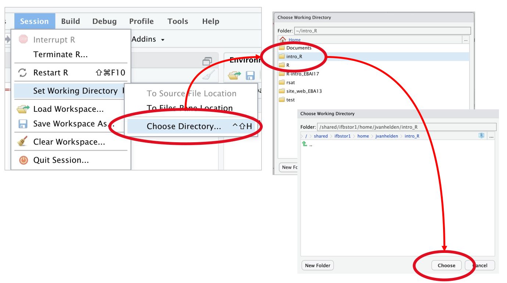</center>

Or use `setwd()`:

```{r}
#| label: change_directory
#| filename: change_directory

setwd("~/introR/intro_R")
```


To load a file with the File pane : 

<center>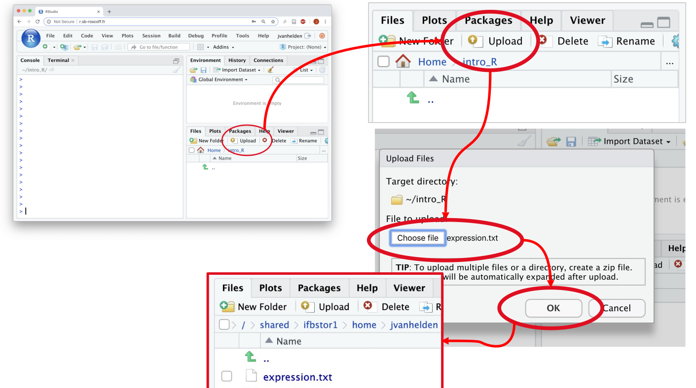</center>


<br>


::: {.callout-note }

RECAP RSTUDIO : 

*  Write command lines in Script pane
*  Execute command lines by hitting CTRL + Enter from script pane et see them in the console.
*  Have a look at the environment and history in case on the upper right pane
*  Search for help in the lower right pane.
*  Use tabulation

:::

<br>

------------------------------------------------------------------------

------------------------------------------------------------------------

<br>
<br>

# R

## Speaking R

### Vocabulary

<br>

R uses a specific vocabulary to describe how we store, manipulate, and analyze information.

-   **Objects** are named containers used to store information. In R, everything is an object !
-   **Elements** are the individual components contained within an object, it has a type and a value.
-   **Data** are the values we work with, while metadata provide information about these values.
-   **Functions** are used to manipulate objects and perform tasks.
-   **Control structures** allow us to control the order in which commands are executed, for example by repeating or conditionally executing instructions.
-   An **algorithm** is a sequence of instructions designed to achieve a specific goal.
-   An **IDE** (Integrated Development Environment), such as RStudio, provides a convenient environment for writing and running R code.

R objects have several characteristics that describe how their content is organized and interpreted, including their **type**, **data structure**, **dimensions**, and **class**.

<br>

### Packages

<br>

A Package is a list of functions,  pipelines, data and documentation shipped under a given name. Every single function you use through R comes from a package or another. 

How calling packages ? There are 2 methods to call a package :
`library()` and `require()`

`library` load in global environment and stop process if the package is not installed at the start of the script

```{r class.source="fold-hide", attr.output='.details summary="Output"'}
#| label: load_library
#| filename: load_library

library(Seurat)
```

`require` load in global environment and return TRUE/FALSE if the package is not installed

```{r class.source="fold-hide", attr.output='.details summary="Output"'}
#| label: load_library2
#| filename: load_library2

require(Seurat)
```

<br>

### How installing packages ?

#### ... in IFB core cluster

You may install a new package on your local computer. You shall not do
it on a cluster. The IFB core cluster you are working on today is **shared**
and highly valuable ; no one can install anything besides the official
maintainers.

The following lines are written for instruction purpose and should not
be used on IFB core cluster.

#### ... in local

<br>

You may install a new package on your local computer. You shall not do
it on a cluster. The IFB core cluster you are working on today is **shared**
and highly valuable ; no one can install anything besides the official
maintainers.

The following lines are written for instruction purpose and should not
be used on IFB core cluster.

<center></center>

There are different functions to install a package :

-   classic

::: {.callout-example icon="false" style="background: pink"}
```{r class.source="fold-hide", attr.output='.details summary="Output"'}
#| label: notrun_3
#| filename: notrun_3

#install.packages("ggplot2")
```
:::

This will raise a prompt asking for simple questions : where to download
from (choose somewhere in France), whether to update other packages or
not.

Do not be afraid by the large amount of things prompted in the console
and let R do the trick.

Alternatively, you can click Tool -\> *Install Packages* in RStudio.

You can list installed packages with `installed.packages()`, and find 
packages that can be updates with `old.packages()`. These packages can be
updated with `update.packages()`.

While the function `install.packages()` searches packages in the common R
package list, many bioinformatics packages are available on other shared
packages warehouses. Just like AppleStore and GoogleStore do not have
the same applications on mobile, R has multiple sources for its
packages. You need to know one of them, and one only **Bioconductor**.

-   bioconductor

::: {.callout-example icon="false" style="background: pink"}
```{r class.source="fold-hide", attr.output='.details summary="Output"'}
#| label: notrun4
#| filename: notrun4

# install.packages("BiocManager")
# BiocManager::install("Seurat")
```
:::

::: {.callout-note icon="false" collapse = "true" style="background: yellow"}
# additional

-   devtools

::: {.callout-example icon="false" style="background: pink"}
```{r class.source="fold-hide", attr.output='.details summary="Output"'}
#| label: notrun5
#| filename: notrun5

# devtools::install_github("depot_github")
# devtools::install_gitlab("depot_gitlab")
```
:::

-   remotes

::: {.callout-example icon="false" style="background: pink"}
```{r class.source="fold-hide", attr.output='.details summary="Output"'}
#| label: notrun6
#| filename: notrun6

# remotes::install_github("depot_github")
# remotes::install_gitlab("depot_gitlab")
```
:::

:::

Today, a package has dependencies that are also packages

<center>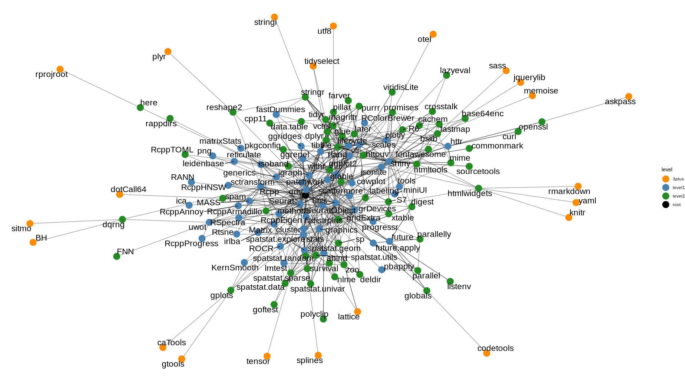</center>

:::{.callout-warning}
Sometime, two package may have a function with the same name. They are most certainly not doing the same thing. It is a good habit to always call a function while precising the package name. `utils::help()` is better than `help()` alone.
:::

<br>

### Few usefull packages for general use

<center>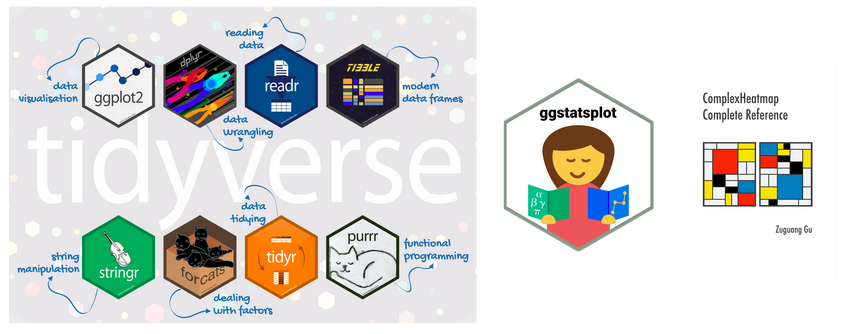</center>

### ... And in single cell/nuclei/spatial transcriptomic

<center></center>

<br>

## Types

<br>

As any language, we use different symbols to different concepts :

*  numbers (integer and double)
*  character
*  boolean (TRUE or FALSE)
*  date
*  factor

<br>

### Numbers

```{r}
#| label: val1
#| filename: val1

val1 <- 3
```

With the code above, the number 3 is stored in a variable called “val1”.
You can do this in R with anything. Literally anything. Whole files,
pipelines, images, anything.

Maths in R works the same as your regular calculator:

```{r}
#| label: addition
#| filename: addition

3 + val1 # Add
```

```{r}
#| label: soustraction
#| filename: soustraction

3 - val1 # Add
```


```{r}
#| label: division
#| filename: division

4 / 2 # Divide
```

```{r}
#| label: multiplication
#| filename: multiplication

3 * 4 # Multiply
```

```{r}
#| label: floor_division
#| filename: floor_division

7 %/% 2 # Floor division
```

::: {.callout-note}
As long as you don't define or re-define the variable with *val1 <- val1 + 3*, the result won't be save in your environment.
:::

<br>

### Characters

Characters are delimited with quotes, either double `"` or single `'` :

```{r}
#| label: characters
#| filename: characters

val2 <- "4"
val5 <- '5'

```

Mathematics does not work with characters at all … Try the following :

```{r}
#| label: error
#| filename: error


# "4" + 1
# val2 + 1
```

You can try to turn characters in numbers with the function: `as.numeric`:

```{r}
#| label: conversion
#| filename: conversion

as.numeric("4") + 1
```

```{r}
#| label: conversion2
#| filename: conversion2

as.numeric(val2) + 1
```


:::{.callout-warning}
Please! Please! Give your variable a name understandable by humans. I
don’t want to see any of you calling their variable `a`, `b`, `my_var` 
```{r class.source="fold-hide", attr.output='.details summary="Output"'}
#| label: store_variable
#| filename: store_variable
# The example below is a very good example of
# how to never ever name a variable.
シ <- "happy"

# This works
myvariable <- 1234
my_variable <- 1234 
myvariable2 <- 1234
myVariable <- 1234
my.variable <- 1234

# These do not work
# my variable <- 1234
# 1234variable <- 1234
# 1234 <- 1234
```


:::

<br>

### Boolean

Aside from characters and numbers, there is another very important type
in R (and computer science in general): **booleans**. There are two boolean
values : **TRUE** and **FALSE**.

```{r}
#| label: test_boolean
#| filename: test_boolean

3 > 4
```

```{r}
#| label: test_boolean2
#| filename: test_boolean2

10 < 2
```

```{r}
#| label: test_boolean3
#| filename: test_boolean3

5 < 10
```

| Operator |	Description |
|:--------:|:------:|
| < |	less than |
| <= |	less than or equal |
| > |	greater than |
| >= |	greater than or equal |
| == |	equal to |
| != |	not equal to |

::: {.callout-note icon="false" collapse="true" style="background: yellow"}
# Additional useful operators

Others useful operators : 

| Operator |	Description |
|:--------:|:------:|
| & |	AND |
| \| |	OR |
| ! |	NOT |
| %in% |	is an element of |
| isTRUE() |	test if TRUE |
| is.na() |	test if NA |

:::

<br>

### Factor

Factor are similar as vector but... it's a categorical vector.

```{r class.source="fold-hide", attr.output='.details summary="Output"'}
#| label: factor
#| filename: factor

timepoint <- factor(  c("tp1", "tp2", "tp3", "tp1", "tp2", "tp3"),
  levels = c("tp1", "tp2", "tp3"),
  ordered = TRUE
)

print(timepoint)
```

```{r class.source="fold-hide", attr.output='.details summary="Output"'}
#| label: table_factor
#| filename: table_factor

table(timepoint)
```

<br>

```{r class.source="fold-hide", attr.output='.details summary="Output"'}
treatment <- c(
  "Saline", "Morphine", "Saline",
  "Morphine", "Morphine", "Saline"
)

treatment <- factor(
  treatment,
  levels = c("Saline", "Morphine")
)

table(treatment)
```

<br>
<br>

## Data Structure

<br>

To manipulate information, we conserve data in a group and it depend of
the type or a combination of type

* vector
* matrix
* array
* list
* data.frame

<br>

### Vector

You can make vectors in R. Don’t panic, there will be no maths in this
presentation.

In R, vectors are created with the function `c()`:

```{r class.source="fold-hide", attr.output='.details summary="Output"'}
#| label: vector
#| filename: vector

vector_numbers <- c("1", "2", "3", "4", "10", "20")
print(vector_numbers)
```

```{r}
#| label: is_vector
#| filename: is_vector

is.vector(vector_numbers)
```

One can select an element of the vector with squared brackets `[` and `]`:

```{r}
#| label: select_element_of_vector
#| filename: select_element_of_vector

vector_numbers[1]
```

One can select multiple elements of a vector with `:`:

```{r}
#| label: select_elements_of_vector2
#| filename: select_elements_of_vector2

vector_numbers[2:4]
```

Ok ? So, vector is simply data in one dimension 

<br>

### Questions

::: {.callout-note icon="false" style="background: lightblue"}
## Question 1

Is there a difference between these two vectors ?

```{r}
#| label: vectors
#| filename: vectors

c_vector <- c("1", "2", "3", "3")
n_vector <- c( 1,   2,   3,   3 )
```
:::

::: {.callout-note icon="false" collapse="true" style="background: lightgreen"}
## Answer 1
```{r class.source="fold-hide" , attr.output='.details summary="Output"'}
#| label: is.equal
#| filename: is.equal

isTRUE(c_vector == n_vector)
```
:::


::: {.callout-note icon="false" style="background: lightblue"}
## Question 2

Can I include both text and numbers in a vector ?

```{r class.source="fold-hide", attr.output='.details summary="Output"'}
#| label: mixed_vectors
#| filename: mixed_vectors

mixed_vector <- c(1, "2", 3)
print(mixed_vector)
```
:::

<br>

### Matrix/Array

**Matrix** is a table in two dimensions : row and column

```{r}
#| label: matrix
#| filename: matrix

mat <- matrix(1:12, nrow=3, ncol=4)
print(mat)
```

To access one element: cross row and column :

```{r class.source="fold-hide", attr.output='.details summary="Output"'}
#| label: matrix2
#| filename: matrix2

mat[2,3]
```

**Array** is a table in 3 and more dimension.

Basically, in 3D, your have a cube, in nD, your have a hypercube.

The advantage of matrices and arrays is that you can apply
transformations to them.

```{r }
#| label: matrix_operation
#| filename: matrix_operation

mat2 <- log(mat)
print(mat2)
```

<br>

### Data.frame

In R, tables are created with the function `data.frame`:

```{r }
#| label: data_frame
#| filename: data_frame

dataframe_numbers <- data.frame(c(1, 3), c(2, 4))
print(dataframe_numbers)
```
Data Frame are two-dimensional tabular structures similar to matrices, where each column can hold a different data type

You can rename columns and row names respectively with function
`colnames()` and `rownames()`.

```{r class.source="fold-hide", attr.output='.details summary="Output"'}
#| label: data_frame_rename
#| filename: data_frame_rename

colnames(dataframe_numbers) <- c("Col_1_3", "Col_2_4")
rownames(dataframe_numbers) <- c("Row_1_2", "Row_3_4")
print(dataframe_numbers)
```

You can access a column and a line of the data frame using squared
brackets `[` and `]`. Use the following syntax: `[row, column]`. Use
either the name of the row/column or its position.

```{r class.source="fold-hide", attr.output='.details summary="Output"'}
#| label: select_row
#| filename: select_row

# Select a row by its name
print(dataframe_numbers["Row_1_2", ])

```

```{r class.source="fold-hide", attr.output='.details summary="Output"'}
#| label: select_row2
#| filename: select_row2

# Select a row by its index
print(dataframe_numbers[1, ])
```

```{r class.source="fold-hide", attr.output='.details summary="Output"'}
#| label: select_column
#| filename: select_column

# Select a column by its name
print(dataframe_numbers[, "Col_1_3"])
```

```{r class.source="fold-hide", attr.output='.details summary="Output"'}
#| label: select_column2
#| filename: select_column2

# Select a column by its index
print(dataframe_numbers[, 1])
```

```{r class.source="fold-hide", attr.output='.details summary="Output"'}
#| label: select_cell
#| filename: select_cell2

 # Select a cell in the table
print(dataframe_numbers["Row_1_2", "Col_1_3"])
```

```{r class.source="fold-hide", attr.output='.details summary="Output"'}
#| label: select_multiple
#| filename: select_multiple

# Select the first two rows and the first column in the table
print(dataframe_numbers[1:2, 1]) 
```

If you like maths, you will remember the order `[row, column]`. If
you’re not familiar with that, then you will do like 99% of all software
engineer: you will write `[column, row]`, and you will get an error.
Trust me. 99%. Remember, an error is never a problem in informatics

<br>

### List

In R, list is a collection of others data structures.
They are commonly used to represent and group the results of analyses. 

```{r class.source="fold-hide" , attr.output='.details summary="Output"'}
#| label: example_list
#| filename: example_list

mylist <- list(genome = c("S.cerevisae", "A.thaliana", "H.sapiens"), # vector
          chromo.count = c(16, 5, 23), # vector
          matrix.show = mat, # matrix
          chromo.type = list(sace = as.roman(1:16), # another list
                             arath = paste0("Chr", 1:5),
                             hsap = c(1:23)))

```

::: {.callout-note icon="false" collapse="true" style="background: yellow"}
# Example using list

```{r class.source="fold-hide" , attr.output='.details summary="Output"'}
#| label: example_using_list
#| filename: example_using_list

# Accessing one element of list
mylist$genome # you accessing rows with '$' (dollar notation)
mylist[[1]] # by index
mylist[["chromo.count"]] # by name

# Accessing subset of list
mylist[c(1, 2)]  # by position
mylist[c("genome", "chromo.type")] 

# Get the matrix row 2 column1
mylist$matrix.show[2, 1]
```
:::

<br>
<br>

### Question
::: {.callout-note icon="false" style="background: lightblue"}
## Question 

Who is what ?

<center>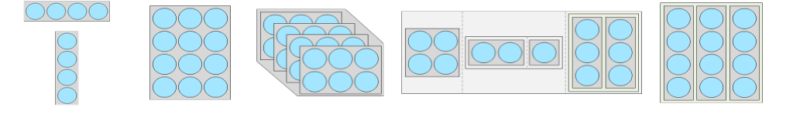</center>
:::

::: {.callout-note icon="false" collapse="true" style="background: lightgreen"}
## Answer 

-   Vectors
-   Matrix
-   Array
-   List
-   Data Frame
:::

<br>
<br>

### Read a table as data frame

Let's look at an example : `example_table.csv` available in
`/shared/projects/2621_eb3in1_2026/atelier_scrnaseq/TD/`

We will use `read.csv` to copy and open the file ./example_table.csv in our project directory.

```{r class.source="fold-hide"}
#| label: import_file
#| filename: import_file

example_table <- read.csv("example_table.csv", header = TRUE, row.names = "Gene_id" )
```

 
Now let us explore this dataset.

We can use the function `head` which prints the first
lines of a table:

```{r class.source="fold-hide", attr.output='.details summary="Output"'}
#| label: head
#| filename: head

head(example_table)
```

::: {.callout-note icon="false" collapse="true" style="background: yellow"}
# Additional load .xlsx

A lot of different functions exits to load data, example with .xlsx:

```{r}
#| label: xlsx
#| filename: xlsx

library(readxl)
example_table_xlsx <- read_xlsx("example_table.xlsx")
head(example_table_xlsx)
```

::: {.callout-note}

You may have noticed that the function `read_xlsx()̀  uploaded a tibble, we will not see this type in this course. But for the more curious, a tibble is a modern version of data.frame. 

:::

:::

The function `summary` describes the dataset per sample:

```{r}
#| label: summary
#| filename: summary

summary(example_table)
```


Have a look at the dataset per gene, using the function `t`
to transpose:

```{r}
#| label: transpose
#| filename: transpose

head(t(example_table))
```

```{r}
#| label: summary_per_gene
#| filename: summary_per_gene

summary(t(example_table))
```
<br>
<br>

## Functions
<br>


Functions are script blocks created to perform specific tasks.

We already saw different functions :

`as.numeric()` - `print()` - `is.vector()` - `data.frame()` - `head()` -
`summary()` - `t()`

We could create new functions :
They are defined as : 

```{r}
#| label: function_example
#| filename: function_example


# Function definition
my_function <- function() { # create a function with the name my_function
  print("Hello World!")
}

# Call the function, functions need the parenthesis 
my_function() # call the function by name once created

# Function with parameters
delta <- function(a, b, c) {
  return (b^2 - 4*a*c)
}

delta(5, 3, 1) # order is a, b, c when not speficied
delta(b = 3, a = 5, c = 2) # best practice is to explicit the parameters

# Function with default parameters
delta <- function(a = 2, b = 1, c = 2) {
  return (b^2 - 4*a*c)
}

delta() # will use default values
delta(5, 3, 1) # will overwrite default values
```


::: {.callout-note icon="false" collapse="true" style="background: yellow"}
# Additional : calculate_toto

```{r}
#| label: define_function
#| filename: define_function

calculate_toto <- function(x,y) {
  
  if (x == 0 & y == x) {
    return("tete a toto !")
  } else {
    return(x + y)
  }
}

calculate_toto(x=0,y=0)
calculate_toto(x=1,y=0)
calculate_toto(x=0,y=1)
calculate_toto(x=1,y=1)
```

If you want to gain time and are sure how to use a function, you don't have to specify arguments names.  **BUT IT IS NOT RECOMMANDED**

```{r class.source="fold-hide", attr.output='.details summary="Output"'}
#| label: use_calculate_toto
#| filename: use_calculate_toto

calculate_toto(0,0)
```

:::

<br>
<br>

## Control Structures

<br>

A script is just an execution flow.

We could modify this flow with :

-   conditional structures
-   loop
-   intern flux structures

<center>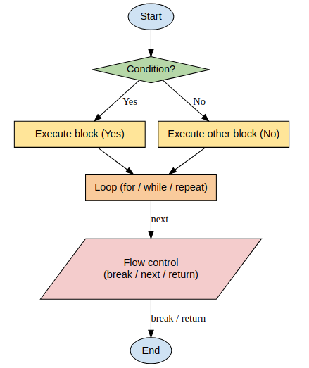</center>

Examples : 
```{r class.source="fold-hide", attr.output='.details summary="Output"'}
#| label: for
#| filename: for

vector_to_print <- c("Hello", "Hola", "Bonjour", "I don't know any other languages :(")

for(element in vector_to_print){
  print(element)
}

```

```{r class.source="fold-hide", attr.output='.details summary="Output"'}
#| label: if
#| filename: if

a <- 4
b <- 2
if (b < a) {
    print("a is greater than b")
} else {
    print("a and b are equal or b is greater than a")
}

```


```{r class.source="fold-hide", attr.output='.details summary="Output"'}
#| label: while
#| filename: while

a <- 4
b <- 2
while(b<a){
  print(b)
  b <- b+1
}
```

<br>
<br>

## Special functions
<br>

Many functions are built to perform specific and optimized tasks:

| Function |	Main purpose |	Key characteristic |
|:---------:|:------------------:|:--------------:|
| ifelse() |	Test a condition on each element	| Vectorized |
| lapply() |	Apply a function to each element	| Always returns a list |
| sapply() |	Apply a function to each element	| Simplifies the output when possible |
| apply()	| Apply a function to rows or columns	| 1 = rows, 2 = columns |
| Filter()	| Select elements based on a condition	| Keeps elements satisfying the condition |
| Map()	| Apply a function to corresponding elements of multiple lists	| Always returns a list |


::: {.callout-note icon="false" collapse="true" style="background: yellow"}
# Example special function

-   Vectorise functions

`ifelse(condition, value_if_true, value_if_false)`

*  Applies a condition to each element of a vector.
*  Returns a vector of the same length as the input.
*  Avoids the need for explicit loops or individual if/else statements.

```{r class.source="fold-hide", attr.output='.details summary="Output"'}
#| label: vectorise_function
#| filename: vectorise_function


scores <- c(12, 8, 15, 7, 20)

results <- ifelse(scores >= 10, "Pass", "Fail")

print(results)

score <- 15
if (score >= 10) {
  print("Pass")
} else {
  print("Fail")
}

```

<br>

-   Iterative applicative functions : apply family

These functions apply another function to multiple elements without explicitly writing a for loop.

`lapply(X, FUN)`

*  Iterates over each element of X.
*  Always returns a list, regardless of the output of FUN.

```{r class.source="fold-hide", attr.output='.details summary="Output"'}
#| label: iterative_function_lapply
#| filename: iterative_function_lapply

my_list <- list(a = 1:5, b = 6:10, c = 11:15)
result_lapply <- lapply(my_list, mean)
print(result_lapply)
```

<br> 

`sapply(X, FUN)`

*  Works like lapply().
*  Automatically tries to simplify the result.
*  Can return a vector, matrix or list.

```{r class.source="fold-hide", attr.output='.details summary="Output"'}
#| label: iterative_function_sapply
#| filename: iterative_function_sapply

result_sapply <- sapply(my_list, mean)
print(result_sapply)
```

<br>

`apply(X, MARGIN, FUN)`

*  Mainly used with matrices and arrays.
*  MARGIN = 1: applies the function to rows.
*  MARGIN = 2: applies the function to columns.

```{r class.source="fold-hide", attr.output='.details summary="Output"'}
#| label: iterative_function_apply
#| filename: iterative_function_apply

mat <- matrix(1:9, nrow = 3, byrow = TRUE)
print(mat)
row_means <- apply(mat, 1, mean)
print(row_means)
col_means <- apply(mat, 2, mean)
print(col_means)
```

<br>

-   Functional functions

`Filter(FUN, x)`

*  Keeps only the elements for which the function returns TRUE.
*  Returns a subset of the original data.

```{r class.source="fold-hide", attr.output='.details summary="Output"'}
#| label: even_numbers
#| filename: even_numbers

numbers <- 1:10

# Garder seulement les nombres pairs
even_numbers <- Filter(function(x) x %% 2 == 0, numbers)

print(even_numbers)

```

<br>

`Map(FUN, ...)`

*  Applies a function simultaneously to corresponding elements of multiple lists or vectors.
*  Always returns a list.
```{r class.source="fold-hide", attr.output='.details summary="Output"'}
#| label: map
#| filename: map

list1 <- list(1, 2, 3)
list2 <- list(10, 20, 30)

# Ajouter les éléments correspondants
result <- Map(function(x, y) x + y, list1, list2)

print(result)
```

:::

<br>
<br>

## Saves

### Save

While working on your projects, you will process datasets in R. The results of these analyses will be stored on variables. This means, that when you close RStudio, some of this work
might be lost.

We already saw the function `save.image()` to save a complete copy of
your working environment.

However, you can save only the content of a give variable. This is
useful when you want to save the result of a function (or a pipeline)
but not the whole 5 hours of work you’ve been spending on
how-to-make-that-pipeline-work-correctly.


The one we will mostly use this week : RDS for R Data Serialization. This is done with
the function `saveRDS()`:

```{r}
#| label: saveRDS
#| filename: saveRDS

saveRDS(object = example_table, file = "example_table.RDS")
```

<br>

### Load


You can also load a RDS into a variable. This is useful when you receive
a RDS from a coworker, or you’d like to keep going your work from a
saved point. This is done with the function `readRDS()`:

```{r}
#| label: readRDS
#| filename: readRDS

example_table <- readRDS(file = "example_table.RDS")
head(example_table)
```

<br>

::: {.callout-note icon="false" collapse="true" style="background: yellow"}
# Additionnal RData

RData is saved with `save()`

```{r}
#| label: save
#| filename: save

save( example_table, file = "example_table.RData")
```


With Rdata, you can directly `load()` the object, it will be load in your environment with the name it had when you saved it. 

Recap : 

|                                            | `.rds`      | `.RData`  |
| ------------------------------------------ | ----------- | --------- |
| Number of objects                            | **1**       | one or several |
| Saving                                 | `saveRDS()` | `save()`  |
| Loading                                 | `readRDS()` | `load()`  |
| Name choice when loading                 | Yes      | No  |
| Modify environement when loading  | No         | Yes       |

::: 

But there are other solutions :

-   `fst`, `qs`, `feather`, `parquet`
-   `csv`, `tsv`, `xlsx`, `yaml`, `json`
-   `SQLite`, `DuckDB`, `HDF5`, `MonetDB Lite`,
    `Feather IPC/Arrow IPC streams`,
-   `gz`, `bz2`, `xz`, `zip`
-   `binaire`

<br>
<br>

## Help

<br>

Directly in the package documentation in Help pane or :

```{r}
#| label: help_reminder
#| filename: help_reminder
#| message: false

?base::print
```

<center></center>

<br>

<center></center>

<br>

<center></center>

<br>

<center></center>

## Writing code in Rstudio

<br>

Ok, it's time to write R code. But how do you do that ? Like a writing a
book !

Best practises :

-   <https://style.tidyverse.org/syntax.html>
-   Comment
-   Script structure

```{r z}
###############################################################################
# Script name : analysis_pipeline.R
# Author      : Your Name
# Date        : 2026-11-15
# Purpose     : Example of clean R script structure
###############################################################################

########################
# 0. Load packages ----
########################
########################
# 1. Define parameters ----
########################
########################
# 2. Define custom functions ----
########################
########################
# 3. Load data ----
########################
########################
# 4. Data cleaning ----
########################
########################
# 5. Analysis ----
########################
########################
# 6. Visualizations ----
########################
########################
# 7. Save outputs ----
########################

```

------------------------------------------------------------------------

------------------------------------------------------------------------
